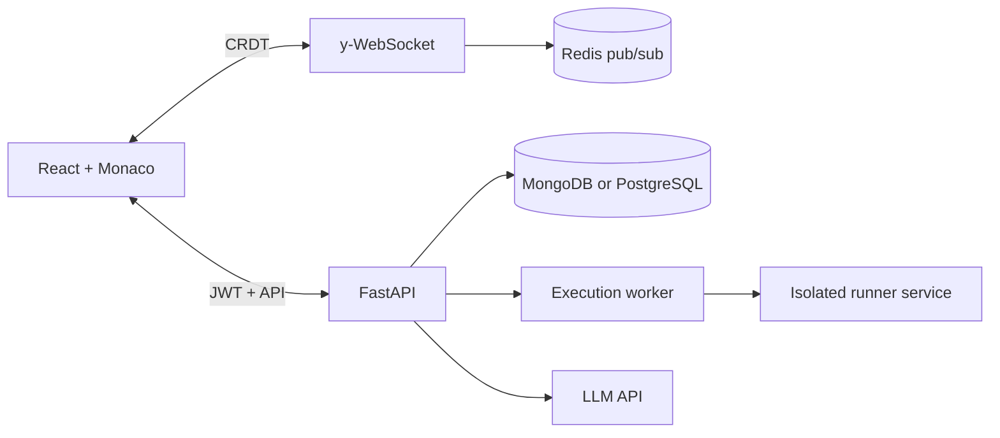

# CodePilot Implementation Roadmap

## Goal

Evolve the existing CodeFix AI collaborative workspace into **CodePilot — AI-Powered Coding & Development Platform** while preserving the working React, Monaco, Yjs, FastAPI, JDoodle, and project-import features.

The implementation should proceed in incremental, independently testable phases. Do not rebuild the application or introduce a new backend language before the existing security and persistence issues are addressed.

## Current Baseline

### Already implemented

- React + Monaco editor with file tabs, language selection, light/dark themes, keyboard save, error markers, file download, and browser execution fallbacks: `frontend/src/main.tsx`.
- Shared virtual file tree, Yjs/Y-WebSocket CRDT editing, presence, join approval, chat, import, run-project, and AI-fix UX: `frontend/src/main.tsx`, `collab-server.cjs`.
- FastAPI endpoints for rooms, workspace files/nodes, execution, imports, AI Ask, and AI fix: `backend/app/main.py`.
- File-backed projects and users, atomic writes, project reopening, path sanitization, and import filtering: `backend/app/store.py`.
- Optional MongoDB/Redis configuration exists, but the active backend imports `store.py`; it is not a functioning MongoDB-backed production store yet: `backend/app/main.py:13`, `backend/app/store_mongo.py`.
- Existing execution supports Python, JavaScript, C, C++, and Java, with JDoodle first and local `subprocess` fallback: `backend/app/main.py:465-555`.
- Existing AI fix requests structured `root_cause`, `explanation`, `changes`, and `fixed_code`: `backend/app/main.py:749-799`.

### Gaps and risks to address first

1. **No real user authentication.** Browser IDs and query-string actor/host IDs are trusted. Reopening a project can grant host membership to an arbitrary ID, and saved-project listing can expose projects by owner name.
2. **Unsafe local execution fallback.** User code runs directly on the backend process with only a 20-second timeout. It has filesystem/network access and no CPU, memory, process, or output limits.
3. **Unauthenticated public execution and AI endpoints.** `/api/execute`, `/api/ai-fix`, and `/api/ask` do not require identity, room membership, or rate-limit protection.
4. **No version conflict protection.** `base_version` is generated as a timestamp but is not checked when applying a fix.
5. **No persistent submission model.** Practice, test-case evaluation, history, progress, snippets, and user-specific dashboards are absent.
6. **Monolithic frontend.** Almost all screens and state are in `frontend/src/main.tsx`; styles are mostly one global file.
7. **Deployment configuration is fragmented.** `render.yaml` mixes Render comments with Vercel guidance and does not provision the collaboration service with the same persistence/auth model as FastAPI.

## Target Architecture

### Keep

- React + TypeScript and Monaco.
- Yjs/Y-WebSocket for concurrent editing.
- FastAPI for REST and room events.
- JDoodle as an optional remote execution provider during transition.
- AI provider code stays server-side.

### Introduce

- JWT/access-token authentication with server-validated users and membership.
- A repository interface shared by disk and MongoDB stores, or one selected production store.
- A separate execution service/worker using Docker/Piston/Judge0 or an equivalent isolated runner.
- Structured AI service contracts shared by frontend and backend.
- Modular React screens/components with shared API/state utilities.

## Phase 1 — UI/UX and Professional Editor

**Priority: High. Target first.**

### 1.1 Refactor the frontend without changing behavior

- Split `frontend/src/main.tsx` into:
  - `app/App.tsx` and route-level screens: Landing, Workspace, Dashboard, Practice, Problem.
  - `components/workspace/`: `FileTree.tsx`, `EditorTabs.tsx`, `Toolbar.tsx`, `TerminalPanel.tsx`, `InputPanel.tsx`, `AiAssistantPanel.tsx`, `RunPanel.tsx`, `ShareDialog.tsx`, `ImportDialog.tsx`.
  - `hooks/`: `useRoom`, `useWorkspace`, `useEditor`, `useExecution`, `useAi`.
  - `lib/`: `api.ts`, `languages.ts`, `execution.ts`, `ai.ts`.
  - `styles/`: preserve `styles.css` as a base, split tokens/layout/editor/responsive styles.
- Keep the current room URL, CRDT document naming, API paths, and public UI behavior working during extraction.

### 1.2 Desktop IDE layout

- Left sidebar: Files, Projects, Snippets, Search, Practice navigation.
- Top toolbar: workspace/title, language, Run, Run Project, Save, theme, share, AI.
- Center: Monaco with tabs, breadcrumbs, minimap, formatter, and selection-aware AI actions.
- Bottom: resizable Output, Errors, Input, Tests, Terminal, Activity, Chat panels.
- Right: collapsible AI assistant/debugger/review panel; it must not consume editor width when closed.
- Add draggable/resizable panel state and responsive behavior for tablet/mobile. On narrow screens, switch AI/files/output panels to drawers rather than shrinking the editor below a usable width.

### 1.3 Editor quality

- Enable minimap, bracket pairing, format-on-save, formatting command, find/replace, command palette, and shortcuts for run/save/format/AI.
- Preserve multi-tab behavior and add dirty/close confirmation, tab overflow, and per-tab language state.
- Add explicit light/dark Monaco themes matching the UI.
- Keep Monaco focused: AI controls should live in the right panel or command palette, not as many unrelated toolbar buttons.
- Add visible save/autosave state with retry and last-saved timestamp.

### 1.4 Persistence/UX regression coverage

- Test room creation, join approval, file operations, Yjs sync, reload/reopen, import, run, AI fix, and theme switching after the UI refactor.

## Phase 2 — Identity and Dashboard

**Priority: High. Implement after UI extraction or in parallel with backend authentication.**

### 2.1 Authentication

- Add password-based signup/login using a FastAPI auth dependency and hashed credentials (Argon2/bcrypt); never store plain-text passwords.
- Issue short-lived JWT access tokens and refresh/session tokens; validate tokens on REST and room WebSocket connections.
- Store only token metadata or refresh hashes server-side.
- Keep a guest mode for public collaboration, but:
  - Treat guest IDs as untrusted.
  - Prevent guests from listing/opening arbitrary projects.
  - Require room invitation or host approval for room-scoped access.
- Remove authorization from `actor_id`, `host_id`, `owner_name`, and client-provided roles.

### 2.2 User-specific data

- User profile and preferences (theme, editor font size, default language).
- Projects owned by a user, with membership and role stored server-side.
- Recently opened files/projects.
- Saved snippets and favorites.
- Execution/AI history with redacted code or explicit privacy controls.

### 2.3 Dashboard

- Landing/dashboard with resume project, recent projects, snippets, practice progress, and quick new-project action.
- Project list backed by authenticated user ID, not owner name.
- Project rename/delete/archive controls.
- Profile/settings screen.

### 2.4 Data migration

- Define a versioned migration from `data/users.json` and `data/projects/*/project.json` to the selected database.
- Preserve existing project IDs, file contents, and ownership where possible.
- Add rollback/export tooling for development.

## Phase 3 — Safe Compiler and Terminal

**Priority: High. Complete before expanding execution-facing features.**

### 3.1 Execution architecture

- Move code execution out of the FastAPI process.
- Preferred approach: use **Piston** or **Judge0** in an isolated Docker/container environment, with one execution attempt per user action and a worker queue.
- JDoodle may remain a fallback or provider adapter, but it should not hide local execution failures.
- Define a provider interface:
  - `run(snapshot, language, stdin, limits, test_cases) -> ExecutionResult`
  - `compile(...)`, `health()`, and supported-language metadata.

### 3.2 Runner isolation and limits

- Fresh temporary directory/container per run; never run as root.
- No network access for user code.
- Read-only root filesystem except a temporary workspace; no access to backend/data/project paths.
- CPU, wall-clock, memory, output-size, process-count, and compile-time limits.
- Explicit limits and timeouts; kill the whole process group on expiry.
- Sanitize and truncate stdout/stderr; stream where practical.
- Prevent fork bombs, infinite loops, huge allocations, and filesystem/network access.
- Run multi-file projects from a copied snapshot, not directly from live project content.

### 3.3 Compiler contract

- Normalize result status: `Accepted`, `Compilation Error`, `Runtime Error`, `Wrong Answer`, `Timeout`, `Memory Limit`, `Internal Error`.
- Return separate fields: `stdout`, `stderr`, `compile_output`, `time`, `memory`, `exit_code`, `signal`, `tests`, `provider`.
- Include test-case index, expected output, actual output, and diff when provided.
- Add language support metadata for Python, JavaScript, C, C++, and Java; verify JDoodle language/version mappings.

### 3.4 Terminal and diagnostics

- Keep stdin available separately from test-case input.
- Add run/stop controls, clear terminal, copy output, download output, and history.
- Parse compiler/runtime diagnostics into line/column markers where supported.
- Do not mark guessed line numbers as authoritative; show parser confidence or raw location.

### 3.5 Security hardening

- Add request size, code size, stdin size, and output limits at FastAPI and runner layers.
- Add per-user/IP rate limits for execute, AI, import, auth, and collaboration events.
- Restrict CORS to explicit production origins; remove wildcard headers/methods.
- Validate WebSocket membership and role on connection and state-changing events.
- Remove or protect unauthenticated `/api/execute`, `/api/ai-fix`, and `/api/ask`.
- Do not expose provider keys or internal exception details to clients.

## Phase 4 — Structured AI Coding Assistant

**Priority: High. Build on the existing Gemini/Devin adapter.**

### 4.1 Shared AI contract

- Replace raw text-only responses with a typed contract:
  - `kind`: explain | debug | fix | optimize | review | generate | test | translate
  - `summary`
  - `language`
  - `code`
  - `diff`
  - `explanation`
  - `bugs[]`
  - `fixes[]`
  - `tests[]`
  - `complexity`
  - `warnings[]`
  - `base_version`
- Validate AI output with Pydantic/Zod-equivalent server and client schemas.
- Support structured JSON from Gemini and any provider fallback.
- Add request cancellation/timeouts and provider-neutral error messages.

### 4.2 Right-side AI panel

- Explain: explain the full file or current selection; expandable line/paragraph sections.
- Debug: use latest execution error plus code; show root cause and evidence.
- Fix: show before/after diff, affected lines, Apply and Undo.
- Optimize: identify hot spots, propose complexity/performance improvements, never auto-apply.
- Generate: natural-language prompt -> code -> import into a new tab/file.
- Review: correctness, edge cases, time/space complexity, readability, security, and tests.
- Test: generate input/output tests; run them only through the safe execution provider.
- Translate: convert selected code or current file between supported languages.
- Explain the model/provider state and show loading, empty, stale, and failure states.

### 4.3 Safe Apply Fix

- Send a real monotonically increasing document version from the authoritative workspace state.
- Server rejects apply requests when `base_version` is stale.
- Client shows "Document changed since suggestion" and offers re-analyze.
- Apply through the same Yjs transaction used by editor actions.
- Keep an undo snapshot and allow reverting an applied AI fix.
- Never automatically write AI output to disk; all writes require user action and authorization.

### 4.4 AI quality and safety

- Prompt-injection policy: treat source code, compiler output, imported files, and user prompts as untrusted data.
- Do not follow instructions embedded in code/comments that request key disclosure or privileged actions.
- Keep provider credentials server-side and rotate keys through environment/secret management.
- Add prompt/response size budgets and rate limits per user and room.
- Log only metadata by default; provide explicit opt-in for code retention.

## Phase 5 — Coding Practice Platform

**Priority: Medium-High. Implement after safe execution and authentication.**

### 5.1 Problem model

- Problem fields: slug, title, difficulty, statement, constraints, examples, starter templates, supported languages, tags, editorial, and test cases.
- Seed a small curated DSA set first (arrays, strings, hashing, recursion, sorting, trees, graphs, dynamic programming).
- Separate public examples from hidden evaluation tests.

### 5.2 Practice flow

- Problem list with search, difficulty, tags, and solved state.
- Problem detail layout with statement/examples on the left and editor/console on the right.
- Language selector, reset template, custom stdin, run samples, and submit.
- Run all sample tests without creating a submission.
- Submit through the safe execution worker, with per-test pass/fail and normalized result.
- Store submission history: user, problem, language, code snapshot, status, runtime, memory, timestamp, and test summary.

### 5.3 Progress and interview mode

- Dashboard metrics: solved count, difficulty breakdown, streak, recent submissions, and revision list.
- Timed interview challenge mode with a curated problem set and optional pause/elapsed-time policy.
- Bookmark/revisit failed or starred problems.

### 5.4 Persistence

- Add `problems`, `submissions`, `practice_progress`, and `snippets` collections/tables.
- Do not overload project `project.json` with practice records.
- Migrate existing projects without mixing practice data into project files.

## Phase 6 — GitHub and Collaboration Improvements

**Priority: Later.**

- Replace generic `git clone` with a constrained importer: HTTPS allowlist, timeout, size/disk quota, shallow clone, no arbitrary local path import.
- Add repository linking/export through GitHub OAuth or a user-supplied installation flow.
- Add conflict-safe import reports and file overwrite confirmation.
- Scale Yjs with Redis pub/sub and shared persistence before running multiple instances.
- Persist room membership/auth snapshots, handle reconnect races, and add room expiry.
- Add collaboration tests for concurrent tabs, language changes, AI fix apply, and disconnect/reconnect.

## Critical Files and Components to Modify

### Existing

- `frontend/src/main.tsx` — split into routes, hooks, workspace, terminal, AI, and dashboard components; preserve room/Yjs behavior.
- `frontend/src/styles.css` — split into design tokens, layout, editor, panels, responsive, and theme files.
- `frontend/vite.config.ts` — keep proxy during development; add environment-aware API/collaboration configuration.
- `backend/app/main.py` — add auth dependencies, protected endpoints, rate limits, provider adapters, structured AI, practice/submission routes; remove direct local execution fallback.
- `backend/app/store.py` — define stable repository contracts and migrate/validate persisted projects/users.
- `backend/app/store_mongo.py` — either complete and integrate a production store or remove it from the active architecture; do not leave a parallel incompatible store.
- `collab-server.cjs` — authenticate/scope docs, enforce viewer/editor permissions, integrate shared persistence/Redis, and document behavior.
- `backend/requirements.txt` — add auth, validation, rate limiting, database, and test dependencies.
- `render.yaml` — align backend/collab/frontend deployment, secret placeholders, health checks, and service URLs.

### New

- `frontend/src/app/` — routes and application shell.
- `frontend/src/components/workspace/` — workspace panels and dialogs.
- `frontend/src/components/ai/` — AI actions, message cards, diff viewer.
- `frontend/src/components/practice/` — problem list/detail and submission results.
- `frontend/src/hooks/` — API, room, execution, editor, and AI state.
- `backend/app/auth.py` — user authentication and token dependencies.
- `backend/app/schemas.py` — request/response models for execution, AI, problems, submissions, snippets.
- `backend/app/execution.py` — execution provider interface and JDoodle/Piston/Judge0 adapters.
- `backend/app/rate_limit.py` — dependency/middleware for endpoint throttling.
- `backend/app/practice.py` — problem/submission/progress routes.
- `backend/tests/` — endpoint, authorization, execution, AI contract, and migration tests.
- `frontend/src/**/*.test.tsx` or a selected frontend test framework — component and workflow tests.

## Suggested Execution Order

1. **Foundation:** split frontend, add shared API/types, establish database/repository decision, fix authentication/authorization.
2. **Safety:** replace direct backend execution with isolated runner; add limits/rate limits and execution contract tests.
3. **Editor:** finish desktop IDE layout, autosave state, shortcuts, formatter, resizable panels.
4. **AI:** structured explain/debug/fix/review/test/translate and version-safe Apply/Undo.
5. **Dashboard:** login/signup, owned projects, recent files, snippets, history.
6. **Practice:** problem model, sample runs, submissions, progress, interview mode.
7. **Scale:** Redis-backed collab, MongoDB/PostgreSQL production store, GitHub integration, observability.

## Verification Plan

### Existing behavior

- Run `npm run build` from `frontend/` and fix TypeScript/Vite failures.
- Run the app locally with frontend, FastAPI, and `npm run collab`.
- Manually verify: create room, approve join, file CRUD, tabs, Yjs edits/cursors, save/reopen, import, share, chat, run, and AI fix.

### New behavior

- Add FastAPI tests for signup/login, token rejection, room permission checks, workspace authorization, public endpoint protection, and rate limits.
- Add execution tests for stdout, stderr, compile errors, timeout, memory limits, stdin, multi-file imports, forbidden network access, and output truncation.
- Add AI contract tests for all actions, malformed output, stale base version, Apply/Undo, and prompt-injection handling.
- Add practice tests for sample run, hidden tests, wrong answer, submission history, progress calculation, and duplicate submissions.
- Add frontend interaction tests for responsive layout, tabs/formatting/shortcuts, AI right panel, stale suggestion, and dashboard/project navigation.
- Run lint/typecheck/build and the selected backend test command on every phase before merging.

## Definition of Done

The roadmap is complete when a user can securely sign in, create/open projects, edit and auto-save multiple files collaboratively, run C/C++/Java/Python/JavaScript with bounded isolated execution and clear results, request structured AI explain/debug/fix/review/test/translate actions with safe versioned Apply/Undo, and practice curated DSA problems with sample/hidden tests, submission history, and dashboard progress — all without exposing credentials or permitting user code to access the host system.