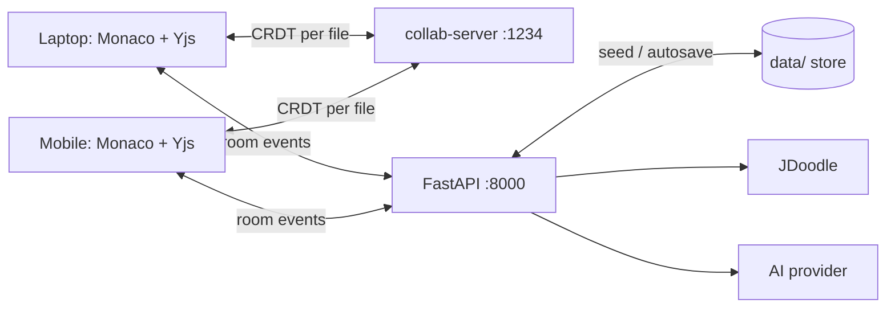

# CodeFix AI

> A real-time collaborative coding platform where teams write, compile, debug, and AI-fix code across devices in one shared workspace.

## What is included

- Responsive React + Monaco **multi-file workspace**: a shared file tree with folders, multi-file tabs, per-file CRDT sub-rooms, and presence dots showing who edits each module.
- CRDT editing through **Yjs**, `y-monaco`, and a `y-websocket` synchronization service (`collab-server.cjs`). Updates are binary CRDT deltas—not whole-document polling or replacement.
- FastAPI authority service: room creation, pending joins, approval, role checking, project persistence (`backend/app/store.py`, file-backed), execution/AI orchestration endpoints, and a validated room event WebSocket.
- Saved projects: new rooms are bootstrapped with starter modules and auto-saved to `data/`; the landing screen lets you reopen any saved project.

## Architecture



Yjs merges concurrent inserts/deletes deterministically. The tree doc (`{room}:tree`) syncs the shared file tree; each open file gets its own sub-room doc (`{room}:{b64url(path)}`) so keystrokes only sync between people viewing that file. The disk store is authoritative — the collab server seeds file docs from disk and writes edits back (debounced), and FastAPI persists the tree/members. Application events such as approvals, chat, execution, and AI suggestions use the FastAPI room socket. The API is deliberately the authority for all roles—clients cannot grant themselves access.

## Start

```bash
cp .env.example .env
```

**Frontend:**

```bash
cd frontend
npm install
npm run dev
```

**Backend:**

```bash
cd backend
pip install -r requirements.txt
uvicorn app.main:app --reload
```

**Collaboration server (for real-time editing):**

```bash
npm run collab
```

Open `http://localhost:5173`.

For real compiler output, create a JDoodle Compiler API account and put its credentials in `.env` as `JDOODLE_CLIENT_ID` and `JDOODLE_CLIENT_SECRET`. The Run button sends the current editor snapshot to FastAPI and displays the returned stdout, compilation errors, runtime errors, time, and memory. Credentials stay in the backend and must never be exposed in the frontend.

For live collaboration, start the Yjs server in a separate terminal:

```bash
npm run collab
```

It listens on port `1234` for devices on your Wi-Fi. Share the app using your computer's LAN address (for example `192.168.1.20:5173`), not `localhost`; the shared link identifies the same room and connects both editors to that room's Yjs document.

When opening a QR code from a phone on the same Wi-Fi, use the Share dialog to enter the laptop's LAN address (for example `192.168.1.20:5173`). `localhost` always means the device that scanned the code, so it cannot be used to reach the laptop.

## API and socket events

REST: `POST /api/rooms`, `POST /api/rooms/open`, `GET /api/projects`, `GET|PUT /api/workspace/{rid}/file`, `POST|PUT|DELETE /api/workspace/{rid}/nodes`, `POST /api/workspace/{rid}/import/{json,path,github}`, `POST /api/rooms/{id}/join`, `POST /api/rooms/{id}/members/{user}/approve`, `POST /api/rooms/{id}/execute`, `POST /api/rooms/{id}/execute-project`, `POST /api/rooms/{id}/ai-fix`. Room endpoints take `actor_id` where needed; workspace endpoints require `?actor_id=`.

Room socket: `room:join_request`, `room:join_accepted`, `room:user_joined`, `room:user_left`, `presence:states`, `presence:update`, `room:removed`, `room:closed`, `chat:message`, `execution:start`, `execution:result`, `ai:fix_ready`, `workspace:imported`. Client presence is reported via `editor:activefile`.

## Production notes

Configure JDoodle and an AI provider in the backend services before deployment; never expose their keys to the frontend. Rooms/projects persist to disk via `backend/app/store.py`; for multi-instance deployment, swap the disk store for MongoDB/PostgreSQL and add Redis pub/sub for y-websocket, persist version snapshots (not keystrokes), add JWT guest/session tokens, rate limits, and endpoint-level tests. AI suggestions carry a base document version and must be rejected/re-analysed if the document advanced before apply.
